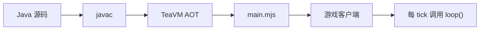

# Screeps Arena Java

**用 Java 写 [Screeps: Arena](https://screeps.com/arena) 的 bot。**


构建时由 [TeaVM](https://teavm.org/) 把 Java 字节码 AOT 编译成游戏客户端直接加载的单个 ES 模块 `main.mjs`。
**对局里没有 JVM**——Java 只是书写语言，游戏运行的仍然是 JavaScript；跨 tick 状态放在 `static` 字段里。



> v0.1.0 · 真机已验证 · 离线回归 8 组全绿 · 免费试玩版可玩教程关

## 快速开始

需要 JDK 17+、Maven 3.9+；离线模拟器另需 Node.js 18+。

```bash
# 构建全部关卡产物（产出 dist/<关卡>/main.mjs）
mvn package

# 离线试跑一局（可选，不用开游戏）
node --import ./tools/register.mjs ./tools/sim.mjs 20 spawn-and-swamp
```

进游戏：**关卡界面 -> 左下角代码目录 -> 选 `dist\spawn-and-swamp`（绝对路径）-> 开一局**。
日志出现 `[screeps-arena-java] 已加载：...`，就说明 Java 产物已经跑起来了。

| 产物 | 内容 |
| --- | --- |
| `dist/spawn-and-swamp/` | 竞技场示例：孵化 + 采集 + 战斗 |
| `dist/capture-the-flag/` | 抢旗示例（v0.1 简化策略，判定待按实际规则重写） |
| `dist/harvest/` | 最小采集循环，入门首选 |
| `dist/probe/` | 绑定库自检 |

一关一个目录，客户端指向哪个目录就是在跑哪份代码。加自己的关卡：复制 `pom.xml` 里任意一段
`<execution>`，改 `<mainClass>` 和 `<targetDirectory>` 即可。

`JAVA_HOME` 没指到 JDK 17+ 时先设置再构建；自定义本地仓库要加引号：
`mvn "-Dmaven.repo.local=D:\maven\repository" package`。

## 写起来是这样

```java
@JSExport
public static void loop() {
    StructureSpawn spawn = GameObjects.mySpawn();
    if (!spawn.isSpawning()) {
        spawn.spawnCreep(List.of(BodyPartType.WORK, BodyPartType.CARRY, BodyPartType.MOVE));
    }
    for (Creep creep : GameObjects.myCreeps()) {
        if (creep.getStore().getFreeCapacity(ResourceType.ENERGY) > 0) {
            creep.harvest(Game.findClosestByRange(creep, GameObjects.sources()));
        } else {
            creep.transfer(spawn, ResourceType.ENERGY);
        }
    }
}
```

API 是 Java 风格的：`List<T>`、枚举（`BodyPartType` / `ErrorCode` / `ResourceType`）、
`isSuccess()` 型结果对象，另有 `Visual` 画图、`PathFinder` 寻路、`raw()` 逃生舱。

**三条规则**：① 入口只导出 `loop()`；② 跨 tick 状态用 `static` 字段；③ `loop()` 里别做重活。
原理与类型边界见 [docs/03 技术原理](docs/03-技术原理.md)。

## 在自己的工程里用

```bash
mvn install    # 先在本仓库把绑定库装进本地 Maven 仓库
```

```xml
<dependency>
  <groupId>io.github.screepsarena</groupId>
  <artifactId>screeps-arena-java</artifactId>
  <version>0.1.0-SNAPSHOT</version>
</dependency>
```

再补上 TeaVM 插件与三个 `provided` 依赖（`teavm-maven-plugin`、`teavm-classlib`、`teavm-jso`、
`teavm-interop`，0.15.0，配置照抄本仓库 `pom.xml`）；入口类写 `@JSExport public static void loop()`。
IntelliJ IDEA 直接当 Maven 工程打开，构建不用离开 IDE。

## 文档与教学

| 入口 | 内容 |
| --- | --- |
| [docs/](docs/README.md) | 架构总览、技术原理、离线模拟与回归、构建使用、路线图 |
| [教学/](教学/README.md) | 游戏 10 关教程中文整理 + Java 对照教学（含过关代码与操作步骤） |
| [iterations/](iterations/README.md) | 想法池与版本记录 |

## 离线回归

```bash
node --import ./tools/register.mjs ./tools/sim.mjs 20 spawn-and-swamp  # 人工观察
node tools/tests/run.mjs "<教程产物目录>"                                # 全量 8 组
```

覆盖绑定库 + 3 个示例 bot + 教程 10 关，每套都在**字符串 id / 数字 id** 两种模式下各跑一遍
（真机 `id` 是 `number | string`，这个坑见 [docs/04](docs/04-离线模拟器与回归.md)）。

## 作者

**zhu1j** · [@zhu1j](https://github.com/zhu1j)

因为想用 Java 玩 Screeps: Arena，却发现社区没有能用的 Java 接入，于是自己写了一个。
欢迎开 Issue 交流、提问、报 bug。

## 致谢

[Screeps: Arena](https://screeps.com/arena) 与[官方文档](https://docs.screeps.com/arena/) ·
社区各语言接入方案的作者 · [TeaVM](https://teavm.org/)

## License

[MIT](LICENSE) © zhu1j

<details>
<summary>为什么需要这个项目？</summary>

官方只提供 JavaScript 运行时。社区已有各语言方案（官方说明：均为社区项目，不提供技术支持）：

| 语言 | 社区方案 |
| --- | --- |
| TypeScript | [typed-screeps-arena](https://github.com/screepers/typed-screeps-arena) · [typescript-starter](https://github.com/screepers/screeps-arena-typescript-starter) · [bun-starter](https://github.com/kounoike/screeps-arena-typescript-bun-starter) · [sample-bot](https://github.com/admon84/screeps-arena-typescript-sample-bot) |
| Python | [python_screeps_arena](https://github.com/EagleBaby/python_screeps_arena) |
| C# | [ScreepsDotNet](https://github.com/thomasfn/ScreepsDotNet) |
| Rust | [screeps-arena-starter-rust](https://github.com/rustyscreeps/screeps-arena-starter-rust) |
| Kotlin | [screeps-arena-starter](https://github.com/Zomis/screeps-arena-starter) |

**Java 一直缺一个能真正在游戏里跑起来的方案，本项目补上这一格。**

</details>
