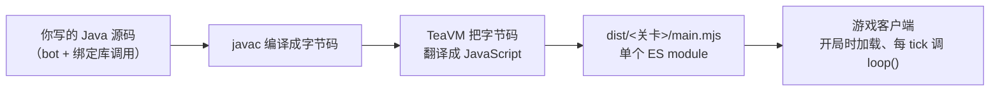

# 01 项目概览

## 这个项目是什么

**Screeps Arena Java** 是一个绑定库 + 工具链：让你用 **Java** 编写
[Screeps: Arena](https://store.steampowered.com/app/1137320/Screeps_Arena/) 的 bot，
构建时把 Java 编译成游戏客户端能加载的单个 `main.mjs`。

游戏官方只提供 JavaScript SDK，社区补充了 TypeScript、Python、C#、Rust、Kotlin 等语言的
绑定/起步工程——但一直没有一个可用的 Java 方案。这个项目就是来补这一格的。

## 为什么"能跑 Java"这件事需要解释

游戏客户端不会运行 JVM，也永远不会。所有语言方案（包括本项目）走的都是同一条路：

所以"用 Java 玩"的准确含义是：

- **写的时候是 Java**：类型系统、IDE 补全、重构、JUnit 式调试都在 Java 侧；
- **跑的时候是 JavaScript**：对局里只有一份纯 JS 产物，没有 JVM、没有解释器；
- **状态跨 tick 保存在"模块的静态字段"里**（整局比赛模块常驻内存），
  也可以把数据挂在游戏对象上（见 [03 技术原理](03-技术原理.md)）。

## 设计原则

| 原则 | 含义 |
| --- | --- |
| 惯用 Java | API 用枚举、`List`、链式 setter、包装类，而不是把 JS 对象原样塞给用户 |
| 零运行时 | 产物不引入任何 JS 运行时依赖，TeaVM 生成的代码直接调用游戏内置模块 |
| 一关一产物 | 一个关卡一个编译单元/目录，客户端指向哪个目录就是在跑哪一关 |
| 离线可验证 | 自带 mock 模拟器与回归套件，不用打开游戏就能跑 tick、验行为 |
| 失败要显性 | 类型不符、原型缺失这类问题宁可返回"没拿到"，也不让强转炸掉整个 tick |

## v0.1 能做什么

- `/game` 核心原型：creep、spawn、tower、extension、container、rampart、wall、road、
  工地、掉落资源、能量矿、旗子；
- 全局函数：tick 数、CPU 时间、地形、距离、方向、查找、放置工地；
- `/game/path-finder`（含 `CostMatrix`）与 `/game/visual` 的常用部分；
- 三个示例 bot（竞技场、采集循环、抢旗）+ 一个自检 bot；
- 离线模拟器与 8 组回归（字符串 id / 数字 id 两种模式）；
- 客户端真实兼容性已经过真机验证（教程第 1 关、竞技场关卡）。

## v0.1 不做什么（明确边界）

- 不做 JVM-in-JS：不追求在 JS 里跑完整 Java 运行时；
- 不覆盖全部赛季关卡：`/arena` 关卡专属原型按需登记（例如 `BodyPart`）；
- 不做完美的战斗/寻路模拟：mock 的常量对齐官方文档，但引擎细节是近似（见 04 文档）；
- 不做 GUI：开发循环是 `mvn package` / `tools/watch.mjs` + 游戏客户端。

## 术语表

| 词 | 含义 |
| --- | --- |
| 绑定层 / binding | `screeps.arena.**` 这层包装类，把游戏内置模块翻译成 Java API |
| 互操作层 | `screeps.arena.internal.Js`（唯一写 `@JSBody` 的地方）与 `Raw`（类型化视图） |
| 产物 / artifact | 编译出来的 `main.mjs`，游戏客户端真正加载的文件 |
| 关卡 / arena | 游戏里的一个玩法（如 Spawn and Swamp、Capture the Flag、教程 10 关） |
| mock | `tools/arena-mock/` 里对游戏内置模块的离线替身 |
