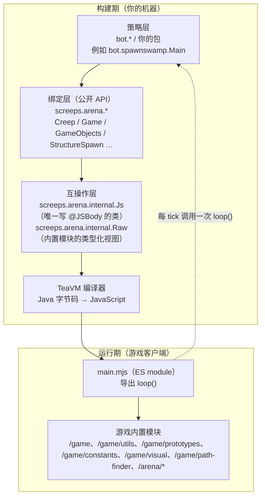
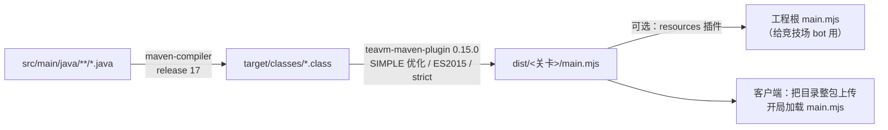
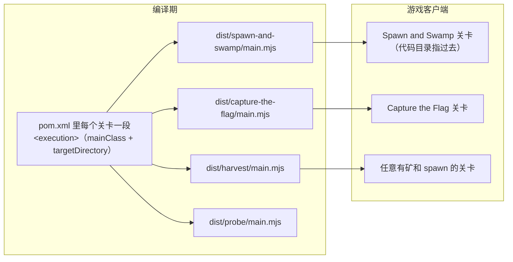
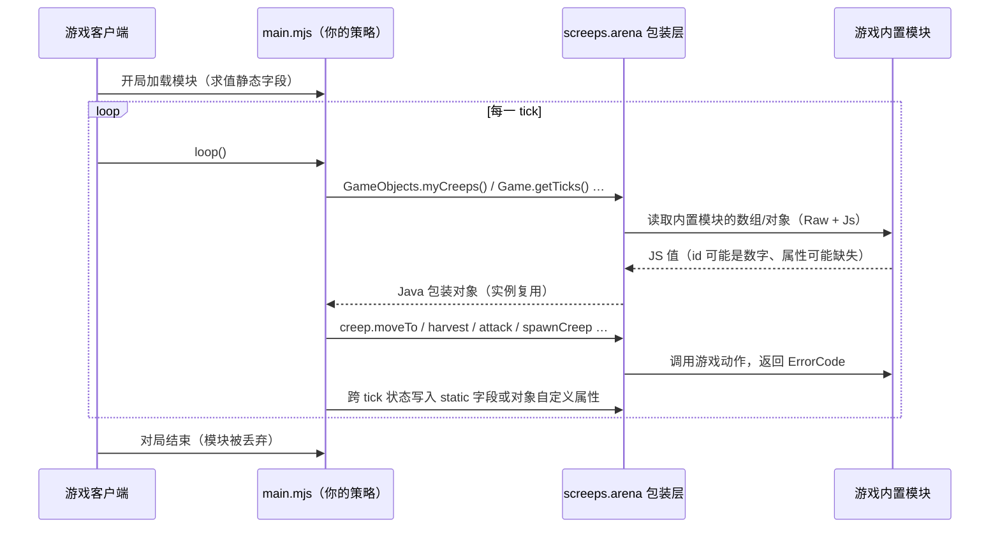

# 02 架构总览

## 分层

从"你写的策略"到"游戏引擎"，一共四层。每一层只依赖下一层：



几点说明：

- **只有 `Js` 一个类直接和 TeaVM 的 `@JSBody` 打交道**。其他所有代码都用 Java 类型 + `Raw` 的接口视图，
  这样"JS 细节"集中在一处，出问题好定位、也好替换；
- `Raw` 是给 `Js` 用的**类型化视图**：用 `@JSProperty` / `@JSMethod` 声明内置模块的形状，
  让 TeaVM 生成属性访问而不是字符串反射；
- 策略层不认识 `Raw`，只认识 `screeps.arena` 的包装类；需要逃生舱时用 `GameObject.raw()`。

## 编译管线



关键插件配置（`pom.xml`）：

| 配置 | 值 | 为什么 |
| --- | --- | --- |
| `targetType` | `JAVASCRIPT` | 输出 JS，不是 WebAssembly |
| `jsModuleType` | `ES2015` | 游戏按 ES module 加载，`import "/game/utils"` 这种模块名要原样保留 |
| `optimizationLevel` | `SIMPLE` | 体积和可调试性的折中；`ADVANCED` 会搅碎函数名、真机报错更难查 |
| `minifying` / `strict` | `false` / `true` | 保留可读性；strict 让互操作层的错误尽早暴露 |
| `mainClass` | 每个 execution 一个入口 | 决定导出 `loop()` 的类，也就是"这关跑哪份策略" |

## 一关一产物：为什么不是运行时分支

游戏里的模块 `/arena` **不是全局模块**：它对应每个赛季/关卡各自的专属原型，
没有这个模块的关卡（教程、Spawn and Swamp）一旦产物里出现 `import "/arena"`，
整份脚本在加载阶段就失败，表现是日志面板一片空白。

所以本项目把"关卡差异"放在**编译期**解决：



同一份源码可以编出多份产物，每份只包含该关卡能走的代码路径；
`tools/sim.mjs` 和 `tools/tests/bots.mjs` 里有静态检查：
产物引用了 `/arena` 而关卡没有这个模块，直接判失败。

## 一次 tick 的生命周期



注意顺序：**先读世界、后做动作**。游戏引擎在一 tick 内的结算规则（同一 tick 的动作冲突、
冷却、孵化倒计时）由内置模块负责，绑定层不做额外缓冲。

## 目录结构

```
src/main/java/screeps/arena/       绑定库（公开 API）
  internal/Js.java                 唯一直接写 @JSBody 的地方
  internal/Raw.java                内置 JS 模块的类型化视图
src/main/java/bot/spawnswamp/      Spawn & Swamp 示例策略
src/main/java/bot/ctf/             Capture the Flag 示例策略
src/main/java/bot/harvest/         采集型示例策略（最简单的那个）
src/main/java/bot/probe/           绑定库自检 bot（不游玩，供回归断言）
tools/                             离线模拟器、真机探针、保存即编译的监视器
  arena-mock/                      内置模块的离线替身
  tests/                           回归套件（probe / bots / smoke / tutorial）
docs/                              本套架构与技术文档
iterations/                        版本路线图与想法池
教学/                              从游戏教程整理的文档 + Java 对照教学
dist/                              构建产物（不进版本库）
```

写策略只需要看两处：`src/main/java/bot/` 里的示例，和 [05 构建与使用](05-构建与使用.md)。
