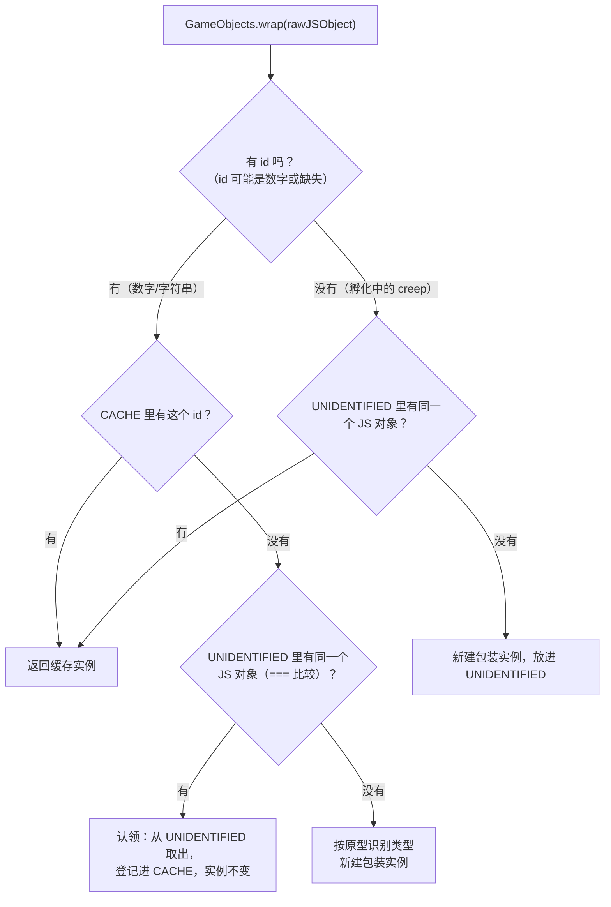

# 03 技术原理

这一篇讲绑定层内部真正"容易踩坑"的东西：TeaVM 怎么工作、JS 值怎么跨界、
对象身份怎么保持、跨 tick 状态放哪。想改绑定层（`src/main/java/screeps/arena/`）之前请先读完。

## TeaVM 把 Java 变成什么

TeaVM 0.15.0 的 JS 后端把 Java 字节码翻译成 JavaScript：

- 每个 Java 类变成一个 JS 函数/对象（方法名会被改写成内部名字，例如 `jl_String__init_1`）；
- `int`/`double` 直接用 JS number，`boolean` 用 JS boolean；
- **`String` 不是 JS string**：是一个带 `$nativeString` 字段的 Java 对象；
- Java 标准库只有一部分被实现（`java.util` 的常用容器、`Math` 等），
  没有 IO/线程/反射那套。

产物形态是一个 ES module，模块顶部是对游戏内置模块的 `import`，底部是字符串池。
报错时看到的是内部函数名，可以拿产物里的 `$rt_stringPool([...])` 反推对应代码。

## 内置模块怎么导入：`@JSBodyImport`

游戏内置模块的模块名是**绝对路径式**的（`/game/utils`、`/game/prototypes`、`/arena/...`），
而 TeaVM 需要知道"这段脚本里用到的模块"：

```java
@JSBody(
        params = {},
        script = "return utils;",
        imports = @JSBodyImport(alias = "utils", fromModule = "/game/utils"))
public static native Raw.Utils utils();
```

两条铁律：

1. `alias` 必须真的在 `script` 里出现。TeaVM 不做"未使用也帮你 import"这种事——
   脚本里没写的别名不会被导入，产物里会留一个未定义标识符，编译期不报错，真机直接 `ReferenceError`。
2. 想取模块上的导出，就写 `模块别名.导出名`（如 `prototypes.Creep`），别写裸的导出名。

## 类型边界：Java ↔ JS

### 字符串和数字（最贵的一课）

TeaVM 给"返回 `String` 的 JS 属性"生成的转换是 `$rt_str(value)`，它**不检查类型**，
只是把值塞进 Java 字符串的 `$nativeString` 字段。而游戏里 `GameObject.id` 的官方类型是
`number|string`，真机给的是**数字**——于是得到一个"内容是数字的字符串"，
一旦被当作 `HashMap` 的 key 就会崩：

```
TypeError: $this.$nativeString.charCodeAt is not a function
TypeError: Cannot read properties of undefined (reading 'length')   // 对象还没有 id 时
```

所以跨界读字符串一律走 `Js.stringOf(value)`：先让 JS 自己执行一次 `String(value)`
（`undefined`/`null` 保留为 Java `null`，表示"没有"）。
详细复盘见 `iterations/ideas/008-js-value-marshalling.md`。

### 数组

TeaVM 的数组自动转换是**按声明类型**逐元素转的：`String[]` 恰好能转对，
`int[]` 会转出一串 `undefined`。绑定层不依赖它——凡是往游戏传数组，
都用 `Js.newArray()` + `Js.setElement` / `Js.setNumberElement` 自己拼 JS 数组。

### 可选属性与"宽松类型"

游戏返回值经常是"二选一的形状"：`{ object }` 或 `{ error }`，缺席的字段是 `undefined`。
所以可选的数值属性读取要经过 `Js.optional` / `Js.numberOrZero`；
布尔判断用 `Js.booleanProperty`（只把真正的 `true` 当 true），
避免 `undefined` 和 0 混进逻辑。

### 形状必须照真机：Visual 的教训

`/game/visual` 导出的是 `class Visual`（实例方法链），不是"带画图函数的模块命名空间"。
绑定层最初按后者实现，`visual.line(...)` 在真机上直接
`TypeError: visual.line is not a function`。mock 当时也照错的样子实现，于是"离线全绿、真机全炸"。

**结论：行为可以是近似，形状不允许是近似。** 形状（是函数还是类、参数几个、返回什么）
是绑定层对真机的下注，必须对着客户端自带的 `arena-docs` 核对。

## 对象身份：同一个游戏对象 = 同一个 Java 实例

游戏每 tick 给的都是新的 JS 包装对象，但绑定层要保证"同一只 creep 在 Java 里始终是同一个对象"，
否则 `==` 比较、往对象上挂字段都会失效。`GameObjects.wrap()` 的策略：



孵化中的 creep 就是这样走完全程的：`spawnCreep` 拿到"还没有 id"的对象 →
放进 `UNIDENTIFIED`；孵化完成、对象有了 id → 下一次 `wrap` 时从 `UNIDENTIFIED`
"转正"进 `CACHE`，整局都是同一个 Java 实例。自检 bot 里专门有这条断言
（"孵化完成后认领回同一实例"）。

缓存只在换对局时清空（`GameObjects.clearCache()`），比赛进行中不要调。

## `/arena` 的静态 import 陷阱

`/arena` 不是全局模块，它是"当前关卡专属原型"的容器。产物里的 `import "/arena"`
**只要有，就必须真的存在**，否则整份脚本加载失败（日志面板一片空白）。

处理方式：

- 通用查询路径（`GameObjects.of` 等）绝不引用 `/arena`；
- 只有关卡专属功能才走 `Js.arena()`，且入口是显式登记：
  `GameObjects.registerBodyPart()`，谁用谁引；
- `tools/sim.mjs` 静态扫描产物，替真机提前判死。

## 跨 tick 状态

对局里模块是常驻的，所以：

| 方式 | 写法 | 特点 |
| --- | --- | --- |
| 静态字段 | `private static Creep worker;` | 最直接；推荐主流用法 |
| 对象自定义属性 | `creep.setProperty("role", ...)`、`creep.setPointProperty("home", pos)` | 状态跟着对象走，对象没了状态自然消失 |

注意静态字段是"模块级"的：换一局游戏会重新加载模块，字段自然重置；
不要想着用它跨对局持久化。

## CPU 与产物体积

- 竞技场的 CPU 限制是**墙钟时间**（`arenaInfo.cpuTimeLimit`，单位秒），不是虚拟 CPU tick；
- 所以 `loop()` 里的每一次全地图遍历、每一次字符串拼接都算钱；
- 产物体积与常数因子直接换算成可用操作数，见 `iterations/ideas/004-output-size-and-cpu.md`；
- 目前用 `SIMPLE` 优化 + 不混淆，优先保证真机可调试性；体积优化排期在 v0.2+。

## 代理与逃生舱

绑定层没覆盖到的 API，不需要改库就能试：`GameObject.raw()` 拿到原始 JS 对象，
配合 `Js` 里已有的原语自己取。验证 OK 之后再把它收进 `Raw` + 包装类，
这条"先逃生、后固化"的路径能显著降低试新 API 的成本。
