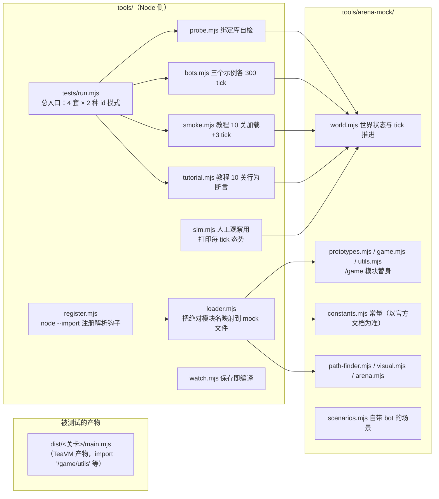

# 04 离线模拟器与回归

## 为什么要有 mock

真机反馈链太长：改代码 → `mvn package` → 重开对局 → 人眼盯日志。
离线模拟器把这条链压缩到毫秒级：在 Node 里搭一个小世界，加载**和真机一样的产物**
（`dist/<关卡>/main.mjs`），驱动 `loop()` 跑任意 tick 数，然后对行为做断言。

模拟器不判断"能不能赢"，它保证三件事：

1. 产物能加载、`loop()` 不抛异常（TeaVM 输出坏了、模块引用错了要立刻发现）；
2. API 用法正确（返回码、类型、实例复用）；
3. 策略的**基本**行为成立（走到旗子、打死敌人、送回能量、建起塔……）。

## 结构



`loader.mjs` 的映射表：

| 真机模块名 | mock 文件 |
| --- | --- |
| `/game` | `arena-mock/game.mjs` |
| `/game/constants` | `arena-mock/constants.mjs` |
| `/game/prototypes` | `arena-mock/prototypes.mjs` |
| `/game/utils` | `arena-mock/utils.mjs` |
| `/game/path-finder` | `arena-mock/path-finder.mjs` |
| `/game/visual` | `arena-mock/visual.mjs` |
| `/arena`、`/arena/season_beta/capture_the_flag/basic/prototypes` | `arena-mock/arena.mjs` |

## 一次 tick 的推进方式

测试驱动的循环是刻意"先结算、后决策"：

```js
world.reset();
// 搭场景：往 world 里塞 spawn/creep/矿/旗子/地形……
const module_ = await import(产物路径);
for (let tick = 1; tick <= 300; tick++) {
  world.advance();       // 先让世界结算：孵化倒计时、冷却、矿回能、单位 tick
  scenario.eachTick?.(); // 场景自己的补给（例如给 spawn 补能量）
  module_.loop();        // 再跑你的策略
}
```

`world.reset()` 清空对象和日志；`console.log` 会被测试临时接管，用于断言日志内容。

## 两种 id 模式：`MOCK_NUMERIC_IDS`

```powershell
node tools/tests/run.mjs                                   # 字符串 id（默认）
$env:MOCK_NUMERIC_IDS='1'; node tools/tests/run.mjs        # 数字 id（模拟真机）
```

真机上 `GameObject.id` 的类型是 `number|string`，实际给数字。
这个开关让 mock 的 id 也在字符串/数字之间切换，专门抓"把 JS 值当 Java 类型硬用"这一类 bug
（真实案例见 `iterations/ideas/008`）。跑回归**必须两个模式都跑**，`run.mjs` 已经内置。

## 四套测试

| 套件 | 测什么 | 断言方式 |
| --- | --- | --- |
| `probe.mjs` | 绑定库角落：id 读写、`getObjectById` 同实例、孵化中无 id/无实例漂移、工地原型名、body/资源类型、旗子三态、Visual 链式、Store/ticksToDecay/pull/directions | 跑自检 bot `bot.probe.Main`，对 `probe:` 日志做 19 条精确断言 |
| `bots.mjs` | 三个示例 bot 在关卡场景里跑 300 tick | "没抛异常 + 我方 creep 数达到下限" |
| `smoke.mjs` | 教程 10 关产物能否加载、空世界 `loop()` 跑 3 tick | 加载/调用成功 |
| `tutorial.mjs` | 教程 10 关的过关条件（走到旗子、消灭敌人、塔开火、建起 Tower……） | 逐关搭场景 + 行为断言 |

加新断言/新场景的方法：照抄 `tutorial.mjs` 里任意一关的 `scenario(...)`；
给绑定库加新能力时，优先加进 `probe`（它是"关卡用不到但库必须做对"的角落集合）。

## mock 的边界

- **常量以客户端自带 `arena-docs` 的渲染值为准**（`constants.mjs` 顶部写明了核对方法）；
- **行为是近似**：数值对齐了，但引擎细节（疲劳的边角、寻路的完全一致性、pull 的整段跟随）不追求全等；
- 已知不做的：spawn 每 tick 自动回能（官方文档只说 "a little amount"，没有数值，mock 不猜，
  场景里按需手工补能量）；
- mock 的价值在"快速证伪"：产物坏没坏、API 用错没有、策略是否跑通。它不能替代真机验收。
